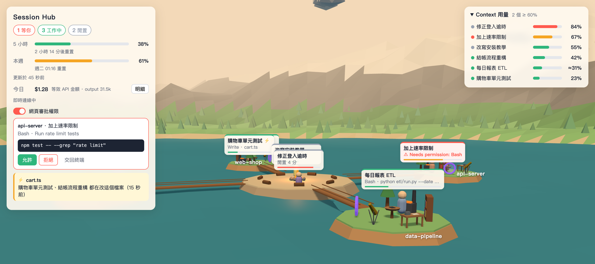
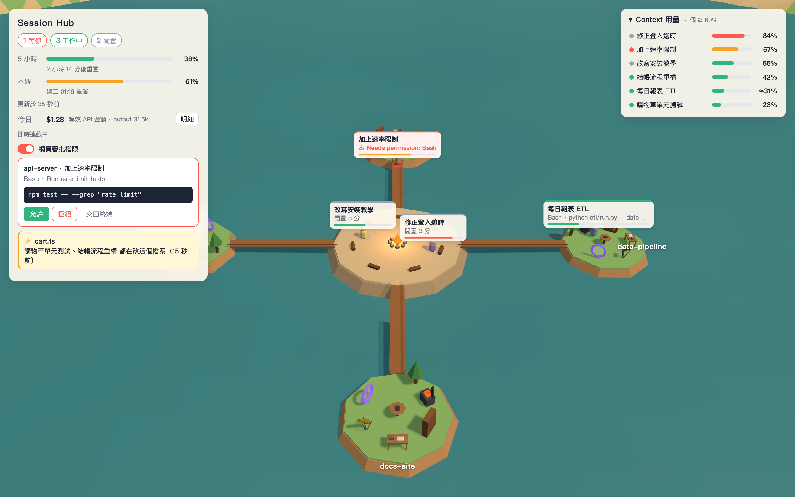
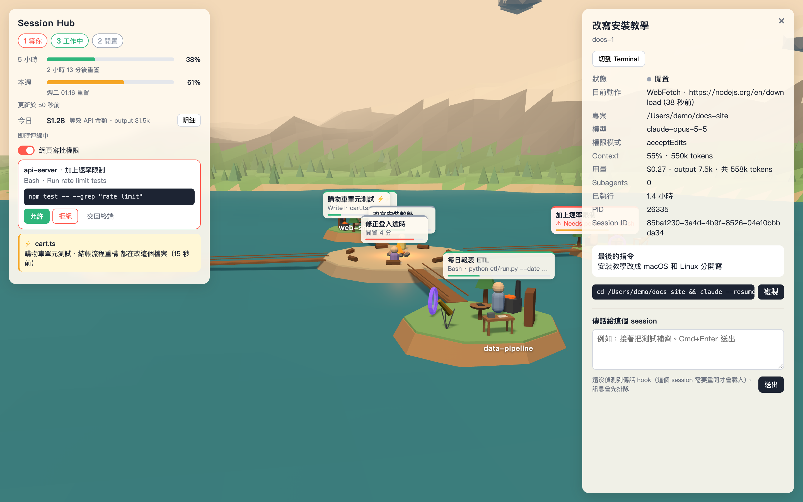
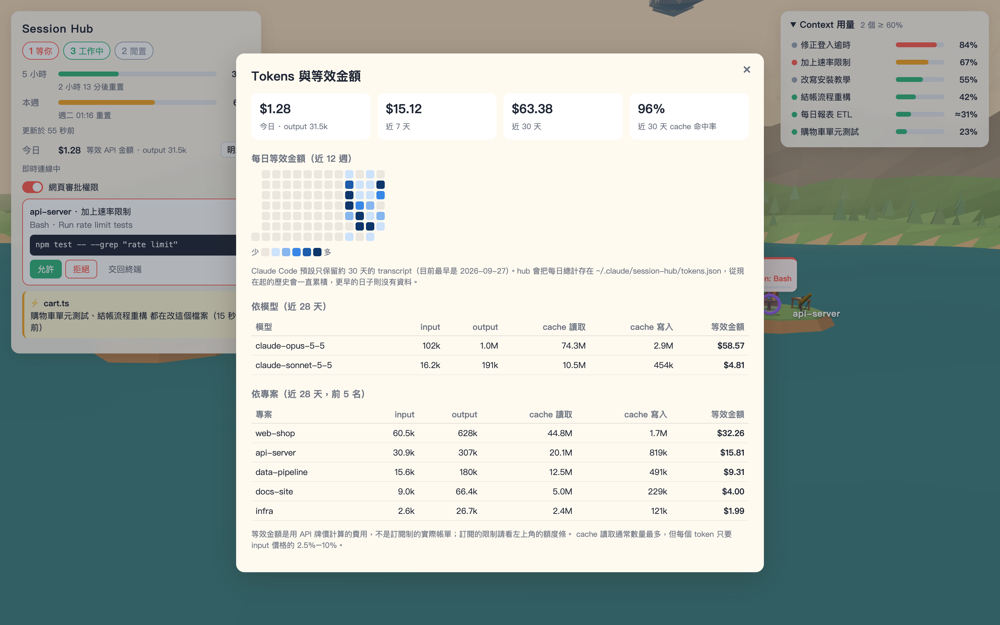
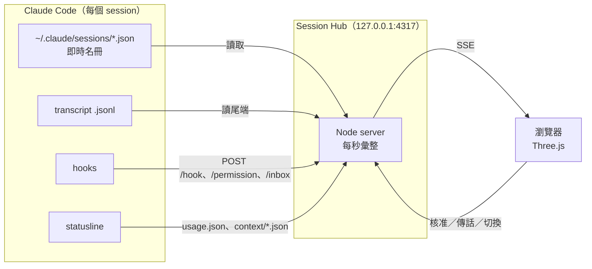

<div align="center">

# 🏝️ Claude Session Hub

**把你電腦上所有正在跑的 Claude Code session，變成 3D 小島上的角色。**

一眼看出誰在工作、誰在等你、誰的 context 快滿了、今天用了多少 token，還能直接在網頁上核准權限、傳話、切回終端機。




</div>

---

## ✨ 功能

| | |
|---|---|
| 🏝️ **一個專案一座島** | 同一個資料夾的 session 住在同一座島上，島之間用橋連到中央營火廣場 |
| 🚶 **角色會依狀態走動** | 工作中走到對應的工作站（Bash→鍛造爐、Read→書架、Edit→工作台、Web→望遠鏡、Agent→傳送門）；等你回應時站在橋頭；閒置就回營火旁坐著 |
| ✅ **網頁審批權限** | 權限請求會出現在 HUD，可以選允許、允許並記住、拒絕或交回終端。預設關閉，關閉時完全不影響原本的流程 |
| 📊 **額度與 context** | 左上角顯示 5 小時和本週的額度與重置時間；右上角列出每個 session 的 context 用量，由高到低排序，60% 以上變黃、80% 以上變紅 |
| ⚡ **檔案衝突警告** | 兩個 session 在 30 分鐘內改了同一個檔案時，角色之間會打閃電，HUD 也會列出檔名 |
| ✉️ **傳話** | 在側欄打字送給某個 session。它閒置時會立刻被喚醒，忙碌時就排隊等這一輪結束 |
| 🖥️ **切回終端機** | 雙擊角色就會跳到 Terminal.app 裡對應的分頁 |
| 💰 **Tokens 與等效金額** | 左上角顯示今日的等效金額，按「明細」可以看每日熱力圖、依模型與專案的明細，以及 cache 命中率。從 transcript 統計 input／output／cache tokens，用 API 牌價換算；側欄也會顯示單一 session 的用量 |
| 🎆 **完成煙火** | 一個 session 連續工作超過 45 秒後結束，會放一次煙火 |
| 🔔 **macOS 通知** | session 開始等你回應時跳出通知，沒有音效 |

## 📸 畫面

<table>
  <tr>
    <td width="50%"></td>
    <td width="50%"></td>
  </tr>
  <tr>
    <td align="center"><b>總覽</b>：審批卡片、衝突警告與 context 清單</td>
    <td align="center"><b>側欄</b>：狀態、最後的指令、resume 指令與傳話</td>
  </tr>
  <tr>
    <td colspan="2"></td>
  </tr>
  <tr>
    <td colspan="2" align="center"><b>Tokens 與等效金額</b>：每日金額、依模型與專案的明細</td>
  </tr>
</table>

> 截圖中的 session 都是虛構的 demo 資料（`npm run screenshots` 產生），不是真實的工作內容。

## 🚀 快速開始

需要 macOS、Node 20 以上，以及 Claude Code。

```bash
git clone git@github.com:aidankaokao/claude-session-hub.git
cd claude-session-hub

npm run hooks:install   # 在 ~/.claude/settings.json 加上 hooks（會先備份）
npm run usage:install   # 選用：讓 statusline 回報額度與精確的 context %
./start.sh              # 在背景啟動
```

接著打開 **http://127.0.0.1:4317**。

- 裝好 hooks 之後**新開的** session 才會完整回報狀態。已經在跑的 session 仍然看得到，但等待狀態與傳話要重開才有。
- `usage:install` 需要你已經有自訂的 statusline 腳本。額度資料只有 Pro／Max 訂閱才會提供。
- 不需要 `npm install`，這個專案沒有任何 npm 依賴。

### 常用指令

| 指令 | 用途 |
|---|---|
| `./start.sh` ／ `./end.sh` | 背景啟動／關閉 |
| `npm run hub:restart` | 改了 `server/` 之後重啟（改 `public/` 只要重新整理頁面） |
| `npm run hub:status` ／ `hub:logs` | 查看狀態與 log |
| `npm start` | 前景執行，方便除錯 |
| `npm run screenshots` | 用 demo 資料重新產生 README 截圖（需要 Google Chrome） |

### 操作方式

| 動作 | 觸控板 | 滑鼠／鍵盤 |
|---|---|---|
| 平移 | 兩指滑動 | 右鍵拖曳、滾輪、方向鍵／WASD |
| 縮放 | 捏合 | Ctrl + 滾輪 |
| 旋轉 | 三指拖曳 | 左鍵拖曳 |
| 看某個 session | 點角色或右上角清單 | |
| 切到它的終端機 | 雙擊角色 | |

## 🧭 運作原理



| 資料來源 | 拿來做什麼 |
|---|---|
| `~/.claude/sessions/<pid>.json` | 有哪些 session、busy／idle |
| transcript（只讀尾端 256KB） | 標題、最後的指令、目前的工具、改過的檔案、token 數 |
| hooks（`PreToolUse`、`PermissionRequest`、`Notification`…） | 即時狀態、等待原因、網頁審批 |
| `Stop` hook（`asyncRewake`） | 傳話：每輪結束後等 hub 的訊息，有訊息就喚醒 session |
| statusline snippet | 5 小時／週額度、精確的 context % |
| transcript 的 `usage`（全部檔案，含 subagent） | Tokens 與等效金額；以 message id 去除重複，每日總計另存一份 |

所有執行期資料都放在 `~/.claude/session-hub/`。

## 🔒 安全與隱私

- **只聽 127.0.0.1**，不會對外開放。session 資料包含你的 prompt 和檔案路徑。
- 每個請求都會檢查 `Host` header，防止 DNS rebinding。
- 會改變狀態的 `/api/*` 只接受同源的 JSON 請求，hook 端點則拒絕任何帶 `Origin` 的請求，所以其他網站無法替你核准指令。
- 網頁審批**預設關閉**，每次啟動都會重設成關閉。沒有網頁開著時會自動交回終端，最多等 9 分鐘。
- hook 腳本永遠以 exit 0 結束，hub 沒開時也不會卡住你的 session。
- 安裝腳本都會**先備份**，並保留你原本的設定，也可以完整移除。

## 🧹 移除

```bash
./end.sh
npm run hooks:uninstall   # 只移除本專案加的 hooks
npm run usage:uninstall   # statusline 會還原成和原本逐位元相同
rm -rf ~/.claude/session-hub
```

## ⚠️ 已知限制

- 讀取的 `~/.claude/sessions` 與 transcript 是 Claude Code 的**內部格式**，升版後可能會失效。解析邏輯都集中在 `server/sessions.mjs` 和 `server/transcript.mjs`。
- 權限核准後到工具執行完之間沒有任何事件，執行時間長的指令會一直顯示「等你」。
- 衝突偵測只看得到 Edit／Write，看不到用 Bash 改的檔案。
- 切換終端機只支援 Terminal.app，第一次使用時 macOS 會詢問自動化權限。
- 傳話送到 Claude 那邊時是 hook 回饋，不是正式的使用者訊息。
- 等效金額是用 `server/pricing.mjs` 裡的 API 牌價換算的，**不是訂閱制的實際帳單**；有新模型時要手動更新價格表，沒有價格的模型（例如透過 proxy 使用的非 Claude 模型）只計 token。
- Claude Code 預設只保留約 30 天的 transcript。hub 會把每日總計存在 `~/.claude/session-hub/tokens.json`，但開始使用之前的歷史只能回溯到當時還留著的 transcript。

## 📁 專案結構

```
server/        Node 後端（HTTP + SSE，零依賴）
public/        前端（Three.js，透過 importmap 載入，沒有建置步驟）
hooks/         Claude Code 呼叫的 shell hook
scripts/       啟動腳本、hooks／statusline 安裝腳本、demo 截圖
docs/          README 截圖
```

開發細節與設計決策記錄在 [CLAUDE.md](CLAUDE.md)。
